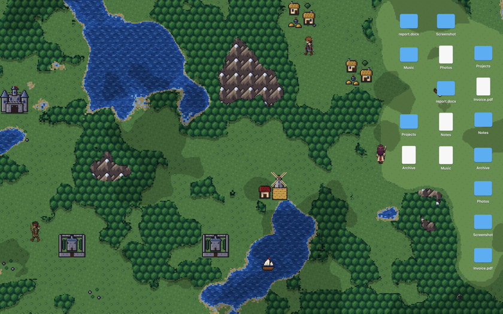
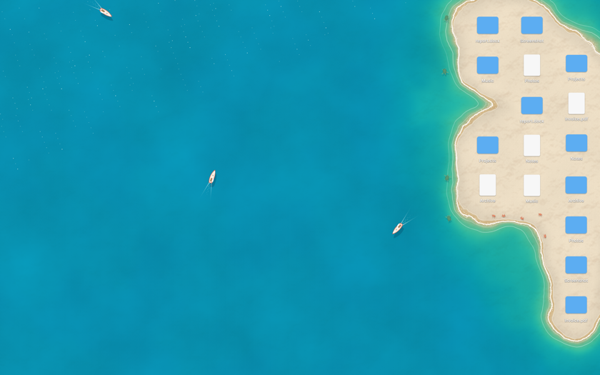
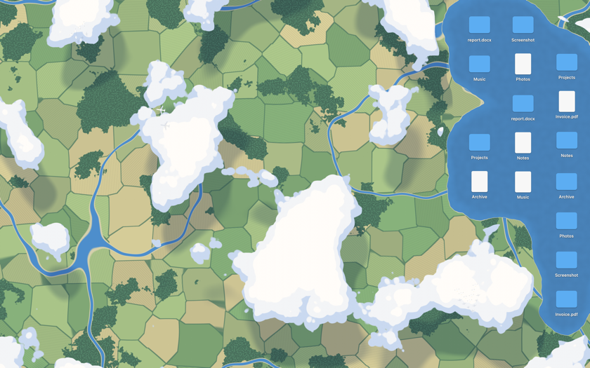
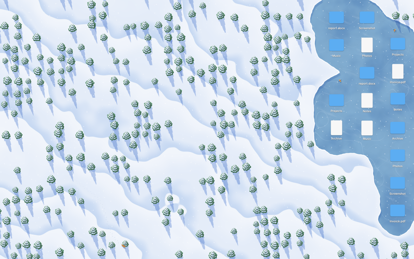
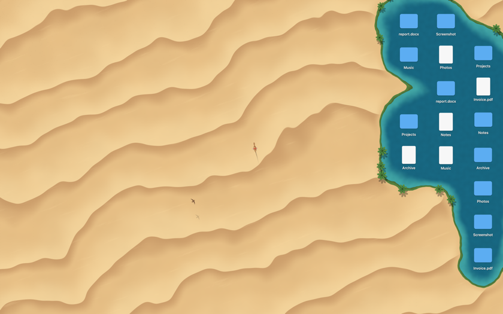
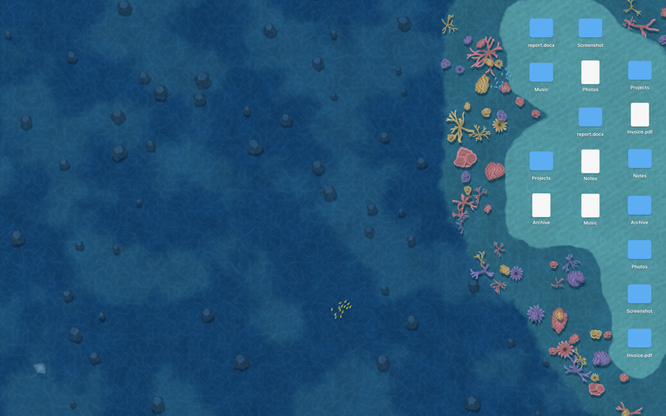
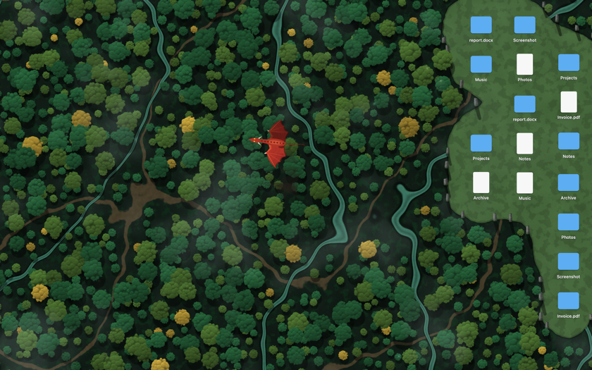
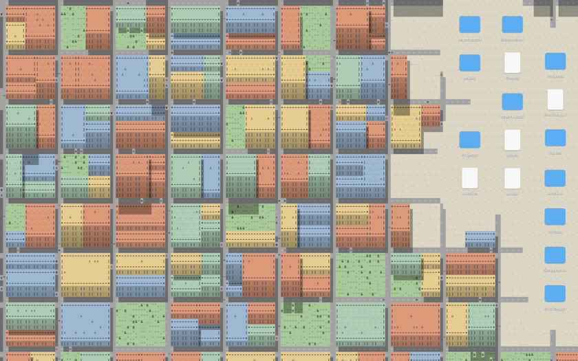

# islo

A living wallpaper for macOS that takes shape around your desktop icons.

islo sits in the menu bar and draws an animated scene behind your icons. Wherever
icons are, the scenery makes room for them: an island rises out of the sea, a
clearing opens in the forest, a platform lights up on the grid. Move an icon and
the land follows. The light follows your clock, with long shadows in the morning
and evening and a moonlit version of every scene at night.



## Themes

| | | |
|---|---|---|
|  Island |  Above the Clouds |  Frozen Lake |
|  Desert Oasis |  Coral Reef |  Neon Grid |
|  Enchanted Forest |  ASCII City |  Pixel Quest |

The screenshots use mock icons; on your Mac the scene forms around your own.

## Requirements

- macOS 13 or later, Apple Silicon or Intel
- To build: Xcode 15 or later

## Install

### Build from source

```sh
git clone https://github.com/nicolopignatelli/islo.git
cd islo
scripts/bundle.sh
open dist/islo.app
```

An app you build yourself opens without any Gatekeeper warning.

### Download

If you download a release instead: islo is not signed with an Apple Developer
ID, so macOS blocks it the first time. Open it once, then go to
**System Settings → Privacy & Security** and click **Open Anyway**.

### Permission

On first launch macOS asks whether islo may control Finder. islo uses this for
one thing: asking Finder where your desktop icons are. It reads positions only,
never file names or contents, and it makes no network connections.

## Use

Click the islo item in the menu bar to pick a theme, pause, or quit.

Command-line options, mostly useful when working on themes:

| Option | What it does |
|---|---|
| `--theme <name>` | Start on a theme: `island`, `clouds`, `lake`, `oasis`, `reef`, `grid`, `forest`, `city`, `pixel` |
| `--hour <0–24>` | Fix the time of day instead of following the clock |
| `--contact-sheet <dir>` | Render every theme over a set of mock icon layouts and exit |

## Known limitations

- The scene is drawn on the main display only.
- Finder reports an icon's new position when you drop it, not while you drag.
- There is no launch-at-login setting yet; add islo to your Login Items by hand.

## How it works

- `IconWatcher` asks Finder for icon positions over Apple Events and re-reads
  them when the Desktop folder changes or the mouse is released.
- `IslandModel` turns the positions into a distance field.
- `Renderer` draws each theme with Metal: a ground pass that is cached, a scene
  pass that animates over it, and sprites for the things that move. All shaders
  are in the `Shader*.swift` files and compiled at launch, so the app is a
  single binary with no resource files.
- `Daylight` works out the sun and moon from the system clock.

### Pixel Quest art

`Sources/islo/PixelArt.swift` is generated. The terrain, places, ship and eagle
are drawn by the Python scripts in `tools/pixelart`; run
`tools/pixelart/regenerate.sh` after changing them (needs Pillow and numpy).

## Acknowledgements

The idea of a wallpaper that reshapes itself around desktop icons comes from
[Deskland](https://deskland.app) for Windows. islo is an independent
implementation for macOS with its own scenes and artwork, and is not affiliated
with Deskland.

## Licence

[MIT](LICENSE)
